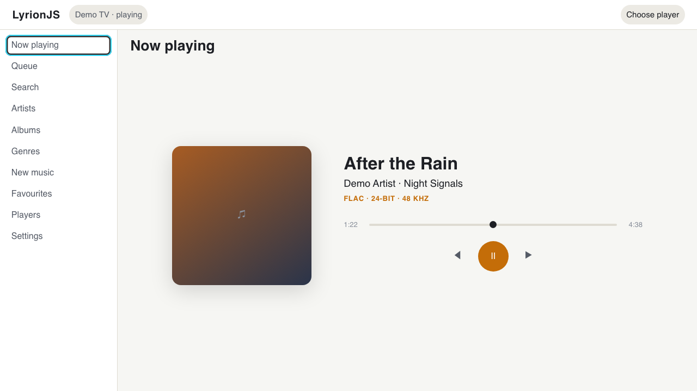
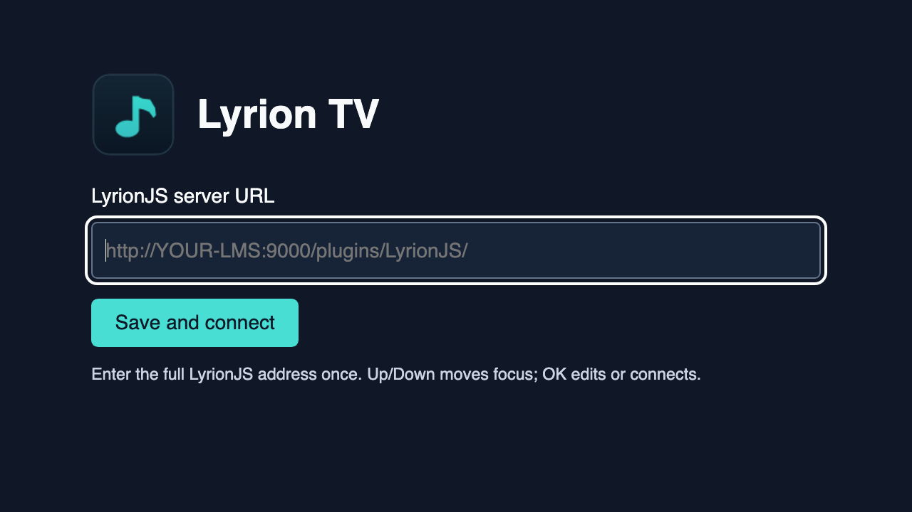

# Lyrion TV

Play your [Lyrion Music Server](https://lyrion.org/) (LMS) library through your LG TV and browse it with the remote. Lyrion TV is a fork of [LyrionJS](https://github.com/JameZUK/LyrionJS) for rooted LG webOS TVs. The TV can play through its own audio output or control another LMS player. It can also join an LMS sync group.

There are two pieces to install. The **webOS launcher** remembers your server address and opens LyrionJS in the TV app runtime. The **LMS plugin** includes the LyrionJS 0.2.34 server code and the TV page with large-screen layout, remote navigation and audio compatibility changes. This fork builds both packages together.



*TV layout preview rendered in a browser with demo data.*

## What you need

- A rooted LG webOS TV with a way to install an IPK, such as Glasshouse. This guide assumes your TV can already sideload apps.
- An LMS 8.0 or later instance reachable from the TV. The build includes the compatible LyrionJS plugin, so you can start with a fresh LMS installation.
- Python 3.9 or later on the computer you build from. The build runs offline once you have the repository.

The compatibility work targets the Chromium 53 app runtime used by older webOS 4.x TVs. Playback and sync can vary by model and audio output.

## Install and connect

1. Build both packages from a checkout of this repository:

   ```sh
   python3 tv/build.py
   ```

2. On the LMS host, stop LMS. If LyrionJS is already installed, back up its directory and move it out of the plugin search paths so LMS loads just one copy. Extract `tv/dist/LyrionJS-0.2.34-tv.zip` into a folder named `LyrionJS` inside an LMS `Plugins` directory. For a container, use a persistent directory mounted into an LMS plugin search path. Check that you have `Plugins/LyrionJS/install.xml` and `Plugins/LyrionJS/HTML/lyrionjs.html`. [Build and deployment details](tv/README.md)
3. Start LMS and check that **LyrionJS** is enabled under **Settings → Plugins**. Open `/plugins/LyrionJS/` on your LMS from a computer to confirm the plugin loads.
4. Install `tv/dist/org.lyrionjs.tv_1.1.0_all.ipk` on the TV, then open **Lyrion TV** from the app launcher. Enter the full address, replacing `lms.example` with your server's hostname or IP and adjusting the port if needed:

   ```text
   http://lms.example:9000/plugins/LyrionJS/
   ```

5. Choose **Save and connect**. In LyrionJS, enable **Play music in this browser** in Settings if needed, select the TV from the player picker, and play a track. Select a different player to control that device instead.



*Launcher setup before connecting to LMS.*

The launcher automatically reconnects to the saved address on later launches. To change it or recover from an unreachable server, fully close and reopen Lyrion TV, then press **Blue** or **OK** during the two-second startup screen. Back can also return to setup when webOS restores the launcher page. Install over the existing app when upgrading to preserve the saved URL.

## Remote controls

| Button | What it does |
| --- | --- |
| Direction pad | Moves the focus ring between controls and scrolls the focused item into view. In launcher setup, Up and Down switch between the address and connect button. |
| OK | Activates the focused control. On a text field or slider, it enters editing so the keyboard or arrows can operate the control. |
| Back | Leaves editing or dismisses an open menu or sheet. When the app has nothing to dismiss, webOS can handle Back normally. |
| Blue | Opens or closes playback diagnostics in the player. On the launcher startup screen, opens setup. |
| Play, Pause, Stop | Controls the selected LMS player. |
| Rewind, Fast Forward | Tap for the previous or next track. Hold to seek backward or forward in 10-second steps on seekable tracks. |
| Volume, Mute | Use the TV's own volume and mute buttons for TV output. |

For remote navigation, start with one of **LyrionJS's own layouts**. Separate LMS skins, including the standalone Material Skin shown inside LyrionJS, manage their own controls.

## Optional URL flags

The plain server URL is enough for most setups. To change a setting, add `?flag=value` to the address, or `&flag=value` if it already has a query string. For example:

```text
http://lms.example:9000/plugins/LyrionJS/?tvui=large&tvschedheadroom=0
```

| Flag | Effect |
| --- | --- |
| `tvui=large` | Makes the TV layout larger, including on direct LMS links. Use `tvui=0` to turn off TV sizing. The launcher defaults to `tvui=1`. |
| `tvdebug=1` | Shows the startup status panel. Use it if the player page fails to load. |
| `tvperf=0` | Disables the playback performance trace. |
| `tvschedheadroom=0` | Uses a 650 ms scheduling window instead of the default one second. Useful for comparing playback or sync behaviour. |
| `tvsynclat=<ms>` | Overrides Scheduled PCM's estimate of output latency with a value from 0 to 1500 ms. Use it to diagnose a consistent sync offset. It changes the clock mapping and does not add a playback delay. |
| `tvpcm=1` | Removes FLAC from the TV player's advertised formats for a server-decoding comparison. LMS needs a suitable conversion rule. MP3 support stays available. |
| `tvschedule=0` | Turns off Scheduled PCM for comparison. The launcher defaults to `tvschedule=1`. |
| `tvsingle=0` | Turns off the shared audio context and the TV audio paths that depend on it, including Scheduled PCM. The launcher defaults to `tvsingle=1`. |
| `tvsmooth=1` | Enables the legacy jitter experiment. To try a larger buffer on the main-thread output path, add `tvbuffer=16384` alongside it. That buffer setting does not apply to Scheduled PCM. |

The launcher always adds `tvnav=1` to enable TV navigation. It preserves the other values you enter.

## Troubleshooting

- **The TV can't connect.** Open the same LyrionJS address on another device on your network. Check the hostname, port and `/plugins/LyrionJS/` path, then reopen launcher setup to correct the address.
- **The page opens but the remote doesn't move focus.** Confirm you launched **Lyrion TV** from the app launcher and that LMS is serving the built HTML. Restart LMS after replacing the file and fully relaunch the TV app. Try `tvdebug=1` for startup status.
- **The interface works but the TV is silent.** Check that **Play music in this browser** is enabled and that the TV is the selected LMS player. Press **Blue** to see the output mode, input format and playback counters.
- **Playback skips or sync drifts.** Play a track on the TV by itself first. Then try one other player in a sync group. Use Blue diagnostics to compare scheduling and sync corrections, and change one URL flag at a time.
- **An LMS plugin update replaced the TV build.** Reinstall the plugin ZIP from this fork and skip upstream LyrionJS updates for this installation. To roll back, stop LMS, remove the TV plugin directory, restore your previous plugin directory if you had one, and start LMS.

## Source and licence

The [TV source and build notes](tv/README.md) cover the pinned base, patch order, optional lifecycle recorder and generated files. The underlying LyrionJS project documents its [architecture](docs/ARCHITECTURE.md) and [development workflow](docs/DEVELOPMENT.md).

LyrionJS is licensed under [GPL-2.0-or-later](LICENSE) with an [app-store distribution exception](LICENSE-EXCEPTION). Lyrion TV is an independent fork.
